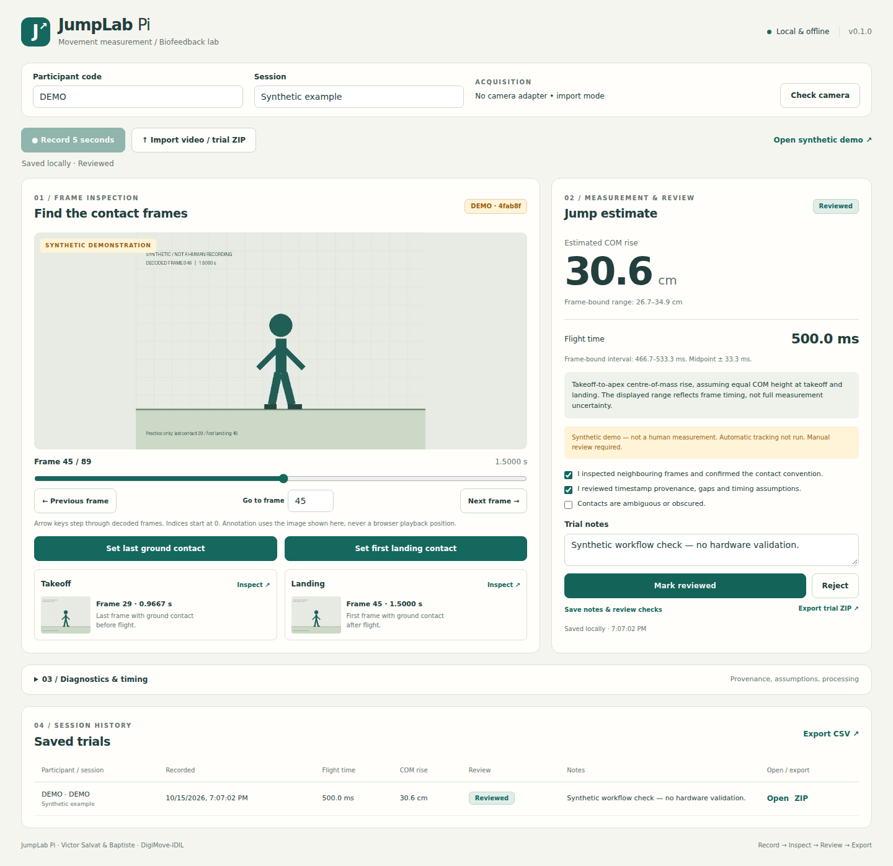

# JumpLab Pi

Projet de M2 DigiMove-IDIL, Université de Montpellier, pour le cours **Measurement and Analysis Chain for Biofeedback** de Pr. Gilles Despaux. Binôme : Victor Salvat et Baptiste.

JumpLab Pi analyse un saut vertical à partir d'une vidéo : inspection image par image, sélection manuelle des contacts, estimation du temps de vol et de l'élévation du centre de masse, revue et export. La cible matérielle est le Raspberry Pi 3B+. Le mode import peut fonctionner sur un ordinateur équipé de Python et FFmpeg.

**État du projet : prototype logiciel v0.1.0.** Dix-sept tests Python et le parcours navigateur ont réussi dans l'environnement de développement Linux. La capture et les performances sur Raspberry Pi n'ont pas été testées ; le matériel de cours a été rendu. Les résultats de démonstration sont synthétiques. La détection automatique est désactivée.

## Lire et évaluer le projet

- [Rapport PDF](report/JumpLab_Pi_Rapport.pdf)
- [Rapport Word modifiable](report/JumpLab_Pi_Rapport.docx)
- [Démarrer sans Raspberry Pi](DEMARRER_SUR_PC.md)
- [Source et installation technique](jumplab-pi/README.md)
- [Bilan des tests](jumplab-pi/docs/VALIDATION.md)
- [Convention de mesure et incertitude](jumplab-pi/docs/MEASUREMENT.md)
- [Acquisition et annotation](jumplab-pi/docs/PROTOCOL.md)
- [Format JSON et CSV](jumplab-pi/docs/FORMAT.md)



Le rapport conserve des emplacements explicites pour les photographies prises par le binôme. Ils doivent être remplacés ou retirés avant le rendu définitif. Le nom complet de Baptiste reste à compléter dans le rapport.

## Démonstration locale

Dans le dossier `jumplab-pi`, après installation de Python et FFmpeg :

```bash
python3 -m jumplab.server
```

Sous Windows, le lanceur `START_WINDOWS.bat` vérifie les dépendances et ouvre le navigateur. L'adresse `http://127.0.0.1:8765` fonctionne uniquement sur l'ordinateur où le programme est lancé. Le dépôt GitHub héberge les fichiers ; il n'exécute pas le serveur Python.

Cliquer sur **Open synthetic demo**, sélectionner le dernier contact à l'image 29 et le premier contact d'atterrissage à l'image 45. Le résultat attendu est 500,0 ms et 30,6 cm. La plage liée à la résolution temporelle est d'environ 466,7 à 533,3 ms. Ce cas vérifie le logiciel, pas une performance humaine.

## Réalisation complémentaire ECG Explorer

Un travail distinct du cours porte sur l'acquisition ECG et l'exploration des signaux enregistrés. **ECG Explorer** permet d'examiner les courbes et les détections produites par cette chaîne :

[Ouvrir ECG Explorer](https://victor-ecg-explorer.hoi987.chatgpt.site/)

Le lien était configuré en accès public lors de la préparation de ce dossier. L'affichage de vos propres mesures nécessite l'import d'un enregistrement compatible ; ne pas supposer qu'un visiteur verra automatiquement les données chargées dans une autre session.

Voir [le dossier complémentaire](companion-ecg/README.md). Il contient le script d'acquisition et d'analyse ECG v1.2.0, avec sa provenance. Le code du tableau de bord hébergé n'est pas inclus. Les données ECG brutes et les portraits ne sont pas inclus dans ce dépôt public. L'ECG ne sert pas à valider les mesures de saut.

## Sources et attribution

La méthode vidéo s'inscrit dans une approche de mesure du temps de vol. JumpLab Pi est indépendant des applications commerciales My Jump et My Jump Lab. Le dépôt Athlete Lens a été inspecté comme référence ; son code n'est pas incorporé. La révision et la licence inspectées sont précisées dans [REFERENCE_REVIEW.md](jumplab-pi/docs/REFERENCE_REVIEW.md).

La préparation du code et de la documentation a bénéficié d'une assistance par IA. Le bilan distingue les contrôles logiciels documentés des essais physiques restant à réaliser. Les droits des photographies et des composants externes restent à leurs auteurs ; aucune licence globale couvrant automatiquement les photos ou les données de participants n'est attribuée par ce dossier.
